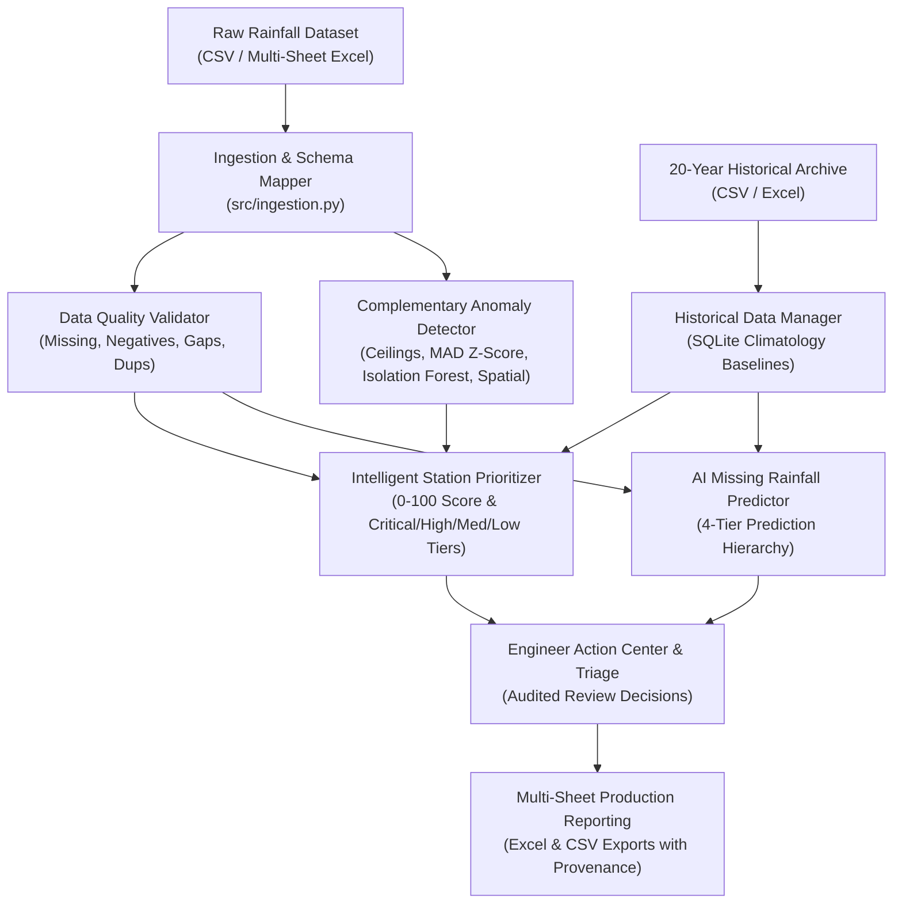

# RainfallIQ: Automated Rainfall Data Quality, Anomaly Detection & Missing-Value Prediction Platform

[](https://www.python.org/downloads/release/python-3110/)
[](https://share.streamlit.io/)
[](Manual_Rainfall_Data_Validation.pdf)
[](tests/)
[](LICENSE)

An enterprise-grade hydrological validation, anomaly detection, gap-filling, and traceable data correction platform built for the **Karnataka Water Resources Information System (KWRIS)** and state water-resource monitoring networks.

Governed by the **Manual on Rainfall Data Validation (National Hydrology Project, Ministry of Water Resources, River Development and Ganga Rejuvenation, Government of India, May 2019)**.

---

## 🏛️ Foundational Hydrological Principles

1. **Flag, Do Not Delete:** Every original observation is permanently preserved. Suspicious readings are flagged for review. Changes require stated reasons and are labeled `corrected` (Manual §2.1.1).
2. **A Test Screens; It Does Not Decide:** No single automated check proves a value wrong. A flag means *"look again"*; spatial context and field data confirm or clear it (Manual §2.1.1.2).
3. **Extremes Can Be Real:** Genuine extreme rainfall is vital for dam safety and flood design. High values are never discarded without neighbouring cross-checks (Manual §4.1).
4. **Zero is NOT Missing:** $0.0\text{ mm}$ means no rain fell; missing means no measurement exists. They are distinct types and never interchanged (Manual §4.10.1).
5. **Measured Beats Estimated:** Field measurements always supersede filled values. Filled gaps are explicitly tagged as **`ESTIMATED — NOT OBSERVED`** (Manual §5.1).

---

## 🏗️ Architecture & Features Overview



### 1. Ingestion & Schema Profiling (`src/ingestion.py`, `src/schema_detection.py`)
- Ingests single/multi-sheet Excel (`.xlsx`, `.xls`) and CSV (`.csv`) files.
- Automatically detects date, station ID, station name, rainfall amount, and geographic coordinates.
- Supports both **long format** (station-date rows) and **wide format** (dates as rows, stations as columns).
- Automatically handles missing codes (`-99`, `-999`, `NA`, `NR`, `NULL`) while strictly preserving zero rainfall ($0.0\text{ mm}$).

### 2. Multi-Method Validation & Anomaly Detection (`src/data_validation.py`, `src/anomaly_detection.py`)
- **Missing Data:** Missing rainfall values, missing dates, and internal sequence date gaps.
- **Invalid Readings:** Negative values ($< 0.0\text{ mm}$), duplicate station-date entries, and non-numeric corrupted strings.
- **Domain Ceilings:** Absolute regional daily physical limit (400 mm PMP benchmark) and daily high warning (200 mm).
- **Robust Statistical Outliers:** Station-specific Median / MAD (Median Absolute Deviation) Z-scores ($> 3.5\sigma$).
- **Unsupervised Machine Learning:** Isolation Forest multivariate anomaly detection on seasonality, month, and magnitude.
- **Spatial Consistency:** Identifies isolated spikes (> 50 mm vs. dry surrounding stations) and missed rain (0.0 mm during network-wide downpour).
- **Extreme Weather Preservation:** Distinguishes *Confirmed Error*, *Suspected Anomaly*, and *Potential Extreme Weather Event*.

### 3. 20-Year Historical Integration (`src/historical_data.py`)
- Ingests and independently validates up to 20 years of historical rainfall observations.
- Tracks station coverage years, data completeness %, and station metadata consistency.
- Computes daily day-of-year ($1 \dots 366$) and monthly climatological distributions (mean, median, 10th percentile, 90th percentile, probability of precipitation).
- Persistent storage backed by SQLite.

### 4. AI-Based Missing Rainfall Prediction Hierarchy (`src/missing_value_prediction.py`)
- **Method 1: Historical Seasonal Baseline:** Station-specific daily/monthly climatology for day-of-year.
- **Method 2: Time-Series Interpolation:** Strictly limited to short internal gaps ($\le 3$ days); forbidden across seasons or extended gaps.
- **Method 3: Machine Learning Prediction:** Random Forest / Gradient Boosting regressor trained on temporal calendar features, rolling 7-day/14-day stats, and lag-1, lag-2, lag-7 rainfall.
- **Method 4: Spatial Estimation:** Inverse Distance Weighting (IDW) from neighbouring stations using Haversine distance.
- All estimates are stamped **`ESTIMATED — NOT OBSERVED`** with prediction intervals, MAE, RMSE, and review status.

### 5. Station Prioritization Engine (`src/prioritization.py`)
- Transparent 0–100 priority score calculated from missing %, gap duration, anomaly severity, historical unreliability, and network criticality.
- Triage tiers: **Critical** ($\ge 70$), **High** ($\ge 45$), **Medium** ($\ge 20$), **Low** ($< 20$).
- Every score is backed by an explicit primary reason and concrete engineering recommendations.

### 6. Interactive Review & Production Reporting (`src/storage.py`, `src/reporting.py`)
- Immutable SQLite audit logging of all engineer approvals, rejections, comments, and timestamps.
- Generates 6-sheet production Excel report with Karnataka Government styling (`#8B0000`).
- Formula injection protection (CWE-1236) sanitization on all spreadsheet exports.

---

## 🗂️ Project Structure

```text
KWRIS/
├── app.py                             # Main Streamlit Application Entrypoint
├── pages/
│   ├── 1_Overview.py                  # Executive Dashboard & Quality Scorecard
│   ├── 2_Upload_Data.py               # Data Ingestion & Schema Profiling
│   ├── 3_Validation_Results.py        # Validation Inspection & Issue Filtering
│   ├── 4_Station_Health.py            # Station Telemetry & Timeline Diagnostics
│   ├── 5_Missing_Value_Prediction.py  # 4-Tier AI Missing Value Imputation
│   ├── 6_Engineer_Action_Center.py    # Triage Queue & Audited Decision Workflow
│   └── 7_Reports_Export.py            # Multi-Sheet Excel & CSV Export Center
├── src/
│   ├── __init__.py                    # Package initialization
│   ├── configuration.py               # Enums, thresholds, weights, and constants
│   ├── schema_detection.py            # Automatic column mapping & format detection
│   ├── ingestion.py                   # File parsing, sheet selection, normalization
│   ├── data_validation.py             # Missing values, negatives, duplicates, sequence gaps
│   ├── anomaly_detection.py           # Domain ceilings, MAD Z-score, Isolation Forest, Spatial
│   ├── historical_data.py             # 20-year archive management & climatology baselines
│   ├── missing_value_prediction.py    # 4-tier prediction hierarchy & interval estimation
│   ├── model_evaluation.py            # Time-aware rolling evaluation (MAE, RMSE, Bias)
│   ├── prioritization.py              # Station triage scoring & quality formula
│   ├── storage.py                     # SQLite persistence & audit review logging
│   └── reporting.py                   # Styled Excel workbook & sanitized CSV exports
├── tests/
│   ├── test_ingestion.py              # Ingestion & schema parsing tests
│   ├── test_validation.py             # Core validation rule tests
│   ├── test_anomaly_detection.py      # Ceilings, MAD Z-scores, spatial tests
│   ├── test_prediction.py             # Prediction hierarchy & time-split tests
│   ├── test_prioritization.py         # Scoring & triage tier tests
│   └── test_reporting.py              # Excel generation & security sanitization tests
├── data/
│   └── sample/
│       ├── sample_current_rainfall.csv     # Operational monsoon dataset (with edge cases)
│       ├── sample_current_rainfall.xlsx    # Operational Excel dataset
│       └── sample_20yr_historical_rainfall.csv # 20-year Karnataka historical baseline
├── .streamlit/
│   └── config.toml                    # Karnataka Crimson UI theme configuration
├── pytest.ini                         # Pytest configuration
├── requirements.txt                   # Production Python dependencies
├── Dockerfile                         # Containerized deployment manifest
├── README.md                          # Platform documentation
└── LICENSE                            # Apache 2.0 License
```

---

## 🚀 Quick Start Guide

### 1. Prerequisites
- Python 3.10 or 3.11 installed.

### 2. Installation
```bash
# Clone the repository
git clone https://github.com/Rupesh4113/KWRIS.git
cd KWRIS

# Create virtual environment
python -m venv .venv
.\.venv\Scripts\Activate.ps1   # Windows PowerShell
# or: source .venv/bin/activate # Linux / macOS

# Install dependencies
pip install -r requirements.txt
```

### 3. Run Automated Tests
```bash
python -m pytest -v
```
*Result: 20 passed tests verifying ingestion, validation, anomalies, predictions, prioritization, and reporting.*

### 4. Launch the Web Application
```bash
streamlit run app.py
```
Open your browser at `http://localhost:8501`.

---

## ⚡ 1-Click Demonstration

On the Home page sidebar or Page 2 (Upload Data), click:
**`⚡ Load Demo Dataset (Monsoon + 20-Yr Baseline)`**

This immediately:
1. Ingests 36,525 records of 20-year daily historical baselines across Karnataka stations.
2. Ingests the 2024 Monsoon operational dataset containing realistic field challenges:
   - Missing codes (`-99`, `-999`, `NaN`)
   - Negative values (`-14.5 mm`)
   - Domain extreme ceiling (`485.0 mm`)
   - Robust statistical outlier (`245.0 mm`)
   - Spatial discordance (`120.0 mm` vs `0.0 mm`)
   - Duplicate station-date records
3. Executes the full validation and anomaly detection engines.
4. Generates station priority rankings and quality scores.

---

## ☁️ Deployment Guide

### Option 1: Streamlit Community Cloud
1. Fork or push this repository to GitHub.
2. Log in to [share.streamlit.io](https://share.streamlit.io/).
3. Connect your repository:
   - **Repository:** `Rupesh4113/KWRIS`
   - **Branch:** `main`
   - **Main file path:** `app.py`
4. Click **Deploy**. The app will automatically build using `requirements.txt`.

### Option 2: Docker Container
```bash
# Build the Docker image
docker build -t rainfall-iq:latest .

# Run the container
docker run -p 8501:8501 rainfall-iq:latest
```
Access the application at `http://localhost:8501`.

---

## 🔒 Security & Data Governance

- **Spreadsheet Formula Injection Prevention (CWE-1236):** All exported strings starting with `=`, `+`, `-`, `@`, `\t`, or `\r` are automatically sanitized with leading apostrophes.
- **Non-Destructive Processing:** Original uploaded measurements are never mutated or deleted; raw readings are preserved side-by-side with estimates.
- **Audit Logging:** Every engineering review action (approval, rejection, notes) is immutably timestamped in SQLite.
- **Traceability:** Every predicted missing observation includes method provenance, out-of-sample MAE/RMSE, confidence bounds, and the label **`ESTIMATED — NOT OBSERVED`**.

---

## 📄 License
This project is licensed under the Apache License 2.0. See the [LICENSE](LICENSE) file for details.
