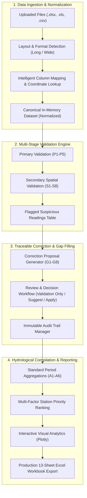

# KWRIS Platform Architecture & System Design

## 1. System Overview

The **KWRIS Rainfall Data Quality Validation & Correction Platform** is an enterprise-grade hydrological validation engine built specifically for the Karnataka Water Resources Information System (KWRIS). It adheres strictly to the **Manual on Rainfall Data Validation (National Hydrology Project, MoWR/RD/GR, Government of India, May 2019)**.

## 2. Core Modules

| Module Path | Core Functionality |
|---|---|
| `streamlit_app.py` | Main application entry point, page routing, and Karnataka-themed layout styling. |
| `src/ingestion.py` | Raw Excel/CSV reader, sheet detector, layout detector (long vs. wide), and schema normalizer. |
| `src/preprocessing.py` | Dataset profiling, sequence date gap detection, missing value categorization, and summary metrics. |
| `src/reference_data.py` | Geodetic Haversine distance, quadrant partitioning (NE, SE, SW, NW), and Karnataka station catalog. |
| `src/primary_validation.py` | Rules P1–P5: Entry checks, minimum limit ($<0$), daily ceiling, monthly upper warning, and dual-gauge comparisons. |
| `src/secondary_validation.py` | Rules S1–S8: Quadrant neighbour selection, IDW estimate test, 1-day date shifts, accumulated totals, and double-mass curves. |
| `src/gap_filling.py` | Rules G1–G8: Keeping missing distinct, second gauge filling, date realignment, proportional distribution of accumulated totals, and normal-ratio neighbour filling. |
| `src/audit.py` | Complete audit trail lifecycle tracking (proposal creation, approval, rejection, deferral, and export). |
| `src/statistics.py` | Rules A1–A6: Standard period aggregations (daily 08:30, 52-week annual, dekads), completeness enforcement ($\ge 90\%$), and Mann-Whitney consistency tests. |
| `src/station_ranking.py` | Multi-factor station triage ranking based on missing rate, doubtful flags, failure severity, and recency. |
| `src/reporting.py` | 13-sheet production Excel report generator using `openpyxl` with styled headers, number formats, and audit logs. |

## 3. Data Integrity & Scientific Guardrails

1. **Zero vs. Missing Distinction:** Genuine dry observations ($0.0\text{ mm}$) are never converted into `NaN`, and missing records are never filled with zero to eliminate blanks.
2. **Preservation of Raw Inputs:** Uploaded source records are preserved in original format in memory and exported in Sheet 2 (`Original_Data`).
3. **Traceability:** Every proposed change records its governing rule code (e.g. `G4`, `G5`), mathematical formula, input stations, timestamp, and review status.
4. **No Silent Modifications:** In validation-only mode, no records are altered. In correction mode, changes are only applied upon explicit reviewer approval.
