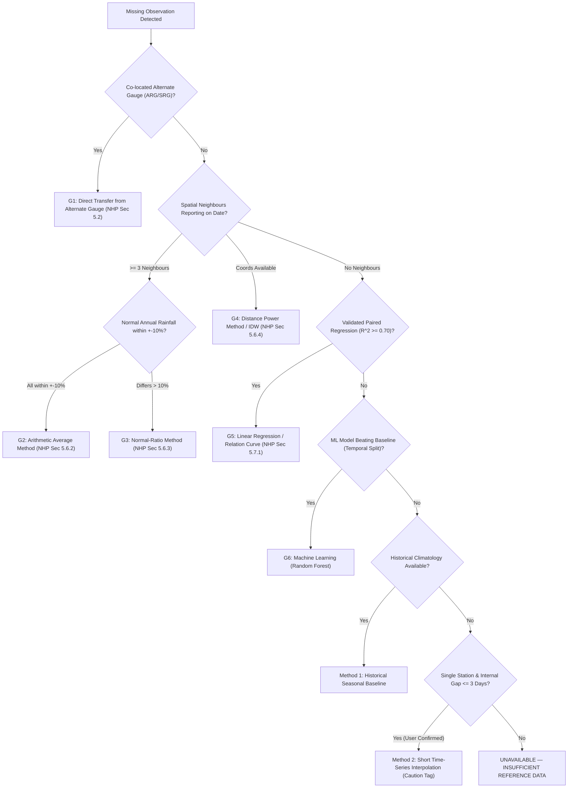

# KWRIS RainfallIQ — Rainfall Data Quality Validation & Imputation Rules Specification

Governing Reference: **Manual on Rainfall Data Validation (National Hydrology Project, Ministry of Water Resources, River Development and Ganga Rejuvenation, Government of India, May 2019)**.

---

## 1. Traceability Matrix Overview

| Rule ID | Rule Name | Governing Reference | Type | Default Severity | Action Type |
| :--- | :--- | :--- | :--- | :--- | :--- |
| **P1** | Format & Ingestion Check | NHP Manual Sec 3.1 & 3.2 | Primary Check | Critical | Flags / Triages |
| **P2** | Minimum Limit Check | NHP Manual Sec 3.4 | Primary Check | Critical | Flags / Flags for Review |
| **P3** | Daily Maximum Limit Ceiling | NHP Manual Sec 3.4 | Primary Check | Critical | Flags Suspicious |
| **P4** | Upper Warning Level | NHP Manual Sec 3.5 | Primary Check | Medium | Flags Warning (Retains) |
| **P5** | Dual-Gauge Co-located Comparison | NHP Manual Sec 3.3 | Primary Check | High / Medium | Flags Inconsistency |
| **S1** | Quadrant Neighbour Selection | NHP Manual Sec 4.6.2 | Spatial Check | Informational | Selects Reference Stations |
| **S2** | Spatial Homogeneity Difference | NHP Manual Sec 4.6.2 | Spatial Check | High / Medium | Flags (+ / - Departure) |
| **S3** | Shifted-Date / Wrong-Day Entry | NHP Manual Sec 4.8 | Spatial Check | High | Flags Shift / Prepares Correction |
| **S4** | Multi-Day Accumulation Screening | NHP Manual Sec 4.9 | Spatial Check | High | Flags Accumulation |
| **S5** | Spatial Deluge / False Zero | NHP Manual Sec 4.10 | Spatial Check | High | Flags Suspected Zero |
| **S6** | Rainy-Day Frequency Consistency | NHP Manual Sec 4.11 | Spatial Check | Medium | Flags Observer Neglect |
| **S7** | Longer Duration Totals (Monthly/Annual) | NHP Manual Sec 4.5 | Spatial Check | High / Medium | Flags Extreme Aggregations |
| **S8** | Double-Mass Curve Trend Analysis | NHP Manual Sec 4.12 | Spatial Check | High / Medium | Flags Systematic Shift |
| **G1** | Alternate Gauge Completion | NHP Manual Sec 5.2 | Estimation Hierarchy | N/A | Estimates (Traceable) |
| **G2** | Arithmetic Average Method | NHP Manual Sec 5.6.2 | Estimation Hierarchy | N/A | Estimates (Traceable) |
| **G3** | Normal-Ratio Method | NHP Manual Sec 5.6.3 | Estimation Hierarchy | N/A | Estimates (Traceable) |
| **G4** | Distance Power Method (IDW $p=2$) | NHP Manual Sec 5.6.4 & 6.3.5 | Estimation Hierarchy | N/A | Estimates (Traceable) |
| **G5** | Validated Linear Regression ($R^2 \ge 0.70$) | NHP Manual Sec 5.7.1 | Estimation Hierarchy | N/A | Estimates (Traceable) |
| **G6** | Machine Learning with Temporal Validation | Engineering Safeguard | Estimation Hierarchy | N/A | Estimates (Traceable) |
| **E1** | Station Timeline & Continuity Validation | Engineering Safeguard (CP1) | Timeline Check | Critical / High | Triages & Prioritizes |
| **E2** | Robust Median / MAD Statistical Spike | Engineering Safeguard | Statistical Check | High / Medium | Flags Outliers |
| **E3** | Unsupervised Isolation Forest Anomaly | Engineering Safeguard | ML Anomaly Check | Medium | Flags Multivariate Anomaly |

---

## 2. Checkpoint 1: Station Timeline & Continuity Validation (E1)

- **Rule ID:** `E1_STATION_TIMELINE`
- **Rule Name:** Station Timeline, Expected Calendar Days, and Continuity Analysis
- **Manual Chapter / Section:** Engineering Safeguard (Pre-requisite to NHP Chapter 3 validation)
- **Input Fields Required:** `date`, `station_code` (or `station_id`), `station_name`, `rainfall`
- **Mathematical Formula / Decision Logic:**
  1. Determine earliest valid date $t_{\min}$ and latest valid date $t_{\max}$ for each unique station.
  2. Compute expected calendar days:
     $$D_{\text{expected}} = (t_{\max} - t_{\min}) + 1$$
  3. Count unique recorded valid observation dates $D_{\text{recorded}}$.
  4. Missing days within window:
     $$D_{\text{missing}} = D_{\text{expected}} - D_{\text{recorded}}$$
  5. Station completeness percentage:
     $$C = \frac{D_{\text{recorded}}}{D_{\text{expected}}} \times 100\%$$
- **Configurable Parameters:**
  - `critical_completeness_pct = 70.0%`
  - `high_completeness_pct = 85.0%`
  - `critical_consecutive_gap_days = 30`
  - `high_consecutive_gap_days = 14`
  - `critical_missing_days = 180`
- **Trigger Condition:** Station completeness $< 85\%$, consecutive missing run $\ge 14$ days, or missing days $\ge 45$.
- **Issue Severity & Explanation:** **Critical** if $C < 70\%$ or gap $\ge 30$ days; **High** if $C < 85\%$ or gap $\ge 14$ days. Explains blackout transmission gaps or decommissioned stations.
- **Recommended Engineering Action:** Prioritize station inspection; recover field logbooks; fill gaps via Chapter 5 spatial estimation hierarchy.
- **Classification:** **Flags and Prioritizes**. Does not overwrite raw records.

---

## 3. Primary Validation Rules (NHP Manual Chapter 3)

### Rule P1: Data Ingestion, Date Format & Record Integrity Check
- **Rule ID:** `P1_ENTRY_CHECK` (Aliases: `V_INVALID_DATE`, `V_DUPLICATE_RECORD`)
- **Rule Name:** Data Entry and Format Verification
- **Manual Reference:** NHP Manual Section 3.1 & 3.2
- **Input Fields:** `date`, `station_id`, `rainfall`
- **Mathematical Formula / Decision Logic:**
  - Dates must parse to valid Gregorian calendar date ($YYYY-MM-DD$).
  - Station code and station name must not be blank or null.
  - Conflicting duplicates: multiple records for identical $(\text{station}, \text{date})$ where values differ.
- **Configurable Parameters:** Format type (`long` or `wide`), date formats allowed.
- **Trigger Condition:** Date parsing failure, null station ID, or duplicate timestamp entries.
- **Severity & Explanation:** **Critical** (Invalid date/station) / **High** (Conflicting duplicate). Corrupted timestamps prevent chronological time series indexing.
- **Recommended Action:** Correct date typo in source logbook; consolidate duplicate readings by checking field transmission slips.
- **Classification:** **Flags / Triages**.

---

### Rule P2: Physical Minimum Limit Check
- **Rule ID:** `P2_MIN_LIMIT` (Alias: `V_NEGATIVE_VALUE`)
- **Rule Name:** Rainfall Physical Non-Negativity Check
- **Manual Reference:** NHP Manual Section 3.4.1 & 3.4.2
- **Input Fields:** `rainfall` (daily total in mm)
- **Mathematical Formula / Decision Logic:**
  $$P(t) \ge 0.0\text{ mm}$$
  If $P(t) < 0.0\text{ mm}$, the record violates physical law.
- **Configurable Parameters:** `min_rainfall_mm = 0.0`
- **Trigger Condition:** $P(t) < 0.0\text{ mm}$.
- **Severity & Explanation:** **Critical**. Daily precipitation cannot be negative. Often caused by sentinel missing codes (e.g. `-99`, `-999`) mistakenly parsed as numerical rainfall.
- **Recommended Action:** Investigate gauge calibration error; convert known sentinel values to `NaN` and estimate via Chapter 5.
- **Classification:** **Flags / Flags for Review**.

---

### Rule P3: Regional Physical Maximum Daily Ceiling Check
- **Rule ID:** `P3_MAX_LIMIT` (Alias: `A_DOMAIN_CEILING`)
- **Rule Name:** Absolute Regional Physical Daily Rainfall Ceiling
- **Manual Reference:** NHP Manual Section 3.4.1 & 3.4.2
- **Input Fields:** `rainfall`
- **Mathematical Formula / Decision Logic:**
  $$P(t) \le P_{\max, \text{regional}}$$
  Regional Probable Maximum Precipitation (PMP) benchmark for Karnataka river basins is $400.0\text{ mm/day}$.
- **Configurable Parameters:** `daily_ceiling_mm = 400.0` (configurable up to $900.0\text{ mm}$ for coastal Western Ghats / Agumbe).
- **Trigger Condition:** $P(t) > \text{daily\_ceiling\_mm}$.
- **Severity & Explanation:** **Critical**. Reading exceeds physical capacity of cloud physics and standard catchment boundaries without extreme cyclonic cloudburst documentation.
- **Recommended Action:** Verify with radar imagery, flood bulletins, and IMD synoptic charts. Check for decimal error (e.g. $450\text{ mm}$ entered instead of $45.0\text{ mm}$).
- **Classification:** **Flags Suspicious**. Retained in database with flag until engineer approves or rejects.

---

### Rule P4: Upper Warning Level Check
- **Rule ID:** `P4_UPPER_WARNING` (Alias: `A_DAILY_WARNING`)
- **Rule Name:** Daily Upper Warning Level (Unusual Rainfall)
- **Manual Reference:** NHP Manual Section 3.5.1 & 3.5.2
- **Input Fields:** `rainfall`
- **Mathematical Formula / Decision Logic:**
  $$P_{\text{warning}} = 200.0\text{ mm/day}$$
  $$P_{\text{monthly\_warning}} = 1000.0\text{ mm/month}$$
  If $P(t) > P_{\text{warning}}$, the value is tagged as an unusual extreme, but **MUST NOT BE AUTOMATICALLY INVALIDATED OR DELETED**.
- **Configurable Parameters:** `daily_warning_mm = 200.0`, `monthly_warning_mm = 1000.0`
- **Trigger Condition:** $200.0\text{ mm} < P(t) \le 400.0\text{ mm}$.
- **Severity & Explanation:** **Medium / Potential Extreme Weather Event**. True extreme rainfall events are the most critical data for hydraulic design, spillway sizing, and flood control.
- **Recommended Action:** Retain value; compare with nearest neighbour stations and flood warnings.
- **Classification:** **Flags Warning (Preserves Value)**.

---

### Rule P5: Dual-Gauge Co-located Comparison (SRG vs ARG)
- **Rule ID:** `P5_DUAL_GAUGE`
- **Rule Name:** Dual-Gauge Co-located Time Series Consistency
- **Manual Reference:** NHP Manual Section 3.3.1 & 3.3.2
- **Input Fields:** `rainfall_srg` (Standard Manual Rain Gauge), `rainfall_arg` (Autographic / Digital Rain Gauge)
- **Mathematical Formula / Decision Logic:**
  1. Calculate absolute daily discrepancy:
     $$\Delta P = |P_{\text{SRG}}(t) - P_{\text{ARG}}(t)|$$
     Condition for discrepancy flag: $\Delta P > \Delta P_{\text{limit}}$ (default $5.0\text{ mm}$).
  2. Detect artificial manipulation: Check if $P_{\text{SRG}}(t) \equiv P_{\text{ARG}}(t)$ across $\ge 10$ heavy rain days ($> 20\text{ mm}$). Due to catch turbulence and bucket resolution, identical daily values indicate forced observer copying.
- **Configurable Parameters:** `dual_gauge_diff_limit_mm = 5.0`
- **Trigger Condition:** Co-located difference $> 5.0\text{ mm}$ or identical matching on non-zero heavy rain events.
- **Severity & Explanation:** **High** ($\Delta P > 15\text{ mm}$) / **Medium** ($5 < \Delta P \le 15\text{ mm}$). Identifies tipping-bucket clogging or observer estimation.
- **Recommended Action:** Compare hourly tipping bucket rate with manual measuring cylinder; accept ARG if logger verified, or adjust SRG (NHP Sec 3.3.2).
- **Classification:** **Flags Inconsistency**.

---

## 4. Secondary Validation Rules (NHP Manual Chapter 4)

### Rule S1: Quadrant Reference Station Selection
- **Rule ID:** `S1_NEIGHBOUR_SELECTION`
- **Rule Name:** Quadrant-Based Spatial Reference Station Selection
- **Manual Reference:** NHP Manual Section 4.6.2 (Equations 4.1 to 4.4, Figure 4.11)
- **Input Fields:** `latitude`, `longitude`, station coordinates
- **Mathematical Formula / Decision Logic:**
  1. Candidate stations must be within circle of influence:
     $$D_i \le R_{\max} = 25.0\text{ km}$$
  2. Calculate compass bearing $\theta_i$ from test station:
     - Quadrant 1 (NE): $0^\circ \le \theta < 90^\circ$
     - Quadrant 2 (SE): $90^\circ \le \theta < 180^\circ$
     - Quadrant 3 (SW): $180^\circ \le \theta < 270^\circ$
     - Quadrant 4 (NW): $270^\circ \le \theta < 360^\circ$
  3. Select at most 2 nearest stations per quadrant.
  4. Total reference stations: $N \le 8$.
- **Configurable Parameters:** `spatial_radius_km = 25.0`, `spatial_max_neighbours = 8`, `spatial_max_per_quadrant = 2`
- **Trigger Condition:** Used internally for all spatial interpolation and homogeneity evaluations.
- **Classification:** **Reference Selection Filter**.

---

### Rule S2: Spatial Homogeneity Difference Check
- **Rule ID:** `S2_SPATIAL_ANOMALY_+`, `S2_SPATIAL_ANOMALY_-`
- **Rule Name:** Spatial Homogeneity Testing (Nearest Neighbour Analysis)
- **Manual Reference:** NHP Manual Section 4.6.2 (Eqns 4.1–4.4, Table 4.5)
- **Input Fields:** `rainfall`, reference stations rainfall $P_i(t)$, distances $D_i$
- **Mathematical Formula / Decision Logic:**
  1. Distance-power weighted spatial estimate:
     $$P_{\text{est}}(t) = \frac{\sum_{i=1}^N \frac{P_i(t)}{D_i^b}}{\sum_{i=1}^N \frac{1}{D_i^b}} \quad (b = 2.0)$$
  2. Standard deviation of neighbours:
     $$S_{P_{\text{est}}}(t) = \sqrt{\frac{1}{N-1} \sum_{i=1}^N (P_i(t) - P_{\text{est}}(t))^2}$$
  3. Limiting departure conditions:
     $$|P_{\text{obs}}(t) - P_{\text{est}}(t)| > X_{\text{abs}} \quad (X_{\text{abs}} = 50.0\text{ mm})$$
     $$|P_{\text{obs}}(t) - P_{\text{est}}(t)| > X_{\text{rel}} \cdot S_{P_{\text{est}}}(t) \quad (X_{\text{rel}} = 2.0)$$
  4. Flag sign:
     - Flag `+` if $P_{\text{obs}}(t) > P_{\text{est}}(t)$ (Unusually high localized spike)
     - Flag `-` if $P_{\text{obs}}(t) < P_{\text{est}}(t)$ (Unusually low / missed rainfall)
- **Configurable Parameters:** `spatial_xabs_mm = 50.0`, `spatial_xrel_stdev = 2.0`, `spatial_distance_power = 2.0`
- **Trigger Condition:** Both absolute difference $> 50.0\text{ mm}$ and relative difference $> 2 \times \text{StDev}$.
- **Severity & Explanation:** **High** (Departure $> 80\text{ mm}$) / **Medium** ($50 < \text{Departure} \le 80\text{ mm}$).
- **Recommended Action:** Investigate for shifted-date entries (S3) or multi-day accumulations (S4).
- **Classification:** **Flags Departure**.

---

### Rule S3: Shifted-Date / Wrong-Day Entry Detection
- **Rule ID:** `S3_SHIFTED_DATE`
- **Rule Name:** Shifted-Date Entry Detection (Observer 1-Day or 2-Day Offset)
- **Manual Reference:** NHP Manual Section 4.8.1, 4.8.2 & 5.3
- **Input Fields:** `rainfall`, reference stations daily series
- **Mathematical Formula / Decision Logic:**
  - **1-Day Observer Lag:**
    On day $t$: $P_{\text{target}}(t) \le 0.1\text{ mm}$ while $\text{Median}(P_{\text{neighbours}}(t)) > 25.0\text{ mm}$.
    On day $t+1$: $P_{\text{target}}(t+1) > 20.0\text{ mm}$ while $\text{Median}(P_{\text{neighbours}}(t+1)) \le 5.0\text{ mm}$.
  - **1-Day Observer Lead:**
    On day $t$: $P_{\text{target}}(t) > 20.0\text{ mm}$ while $\text{Median}(P_{\text{neighbours}}(t)) \le 5.0\text{ mm}$.
    On day $t+1$: $P_{\text{target}}(t+1) \le 0.1\text{ mm}$ while $\text{Median}(P_{\text{neighbours}}(t+1)) > 25.0\text{ mm}$.
- **Configurable Parameters:** `shifted_date_window_days = 1`
- **Trigger Condition:** Isolated pulse offset by exactly 1 or 2 calendar days from regional storm.
- **Severity & Explanation:** **High**. Common observer mistake resulting from clock boundary confusion (08:30 IST) or entering data in the wrong column of the field register.
- **Recommended Action:** Shift recorded value back to the genuine storm date in accordance with NHP Section 5.3.
- **Classification:** **Flags Shift / Prepares Date Alignment**.

---

### Rule S4: Multi-Day Accumulation Screening
- **Rule ID:** `S4_ACCUMULATED_TOTAL`
- **Rule Name:** Unindicated and Indicated Multi-Day Accumulation Detection
- **Manual Reference:** NHP Manual Section 4.9.1, 4.9.2 & 5.4
- **Input Fields:** `rainfall`, reference stations daily series
- **Mathematical Formula / Decision Logic:**
  1. Identify streak of $K$ consecutive dry days ($P(t) \le 0.1\text{ mm}$, where $K \ge 3$).
  2. Followed by a sudden large pulse $P_{\text{spike}} \ge 40.0\text{ mm}$ on day $t_K$.
  3. Compare $P_{\text{spike}}$ with the cumulative sum of surrounding stations over that exact dry spell:
     $$P_{\text{neighbours, cum}} = \sum_{j=1}^K P_{\text{neighbours}}(t_j)$$
  4. If $P_{\text{neighbours, cum}} \ge 25.0\text{ mm}$ and ratio satisfies:
     $$0.65 \le \frac{P_{\text{spike}}}{P_{\text{neighbours, cum}}} \le 1.45$$
- **Configurable Parameters:** `accumulation_dry_days_min = 3`, `accumulation_spike_threshold_mm = 40.0`
- **Trigger Condition:** Observer absence over weekend or holiday followed by dumping the entire accumulated rainfall into a single daily entry.
- **Severity & Explanation:** **High**. Falsely distorts single-day maximum rainfall and IDF curves.
- **Recommended Action:** Apportion the accumulated value across the missing days proportional to neighbour distribution (NHP Section 5.4).
- **Classification:** **Flags Accumulation / Prepares Apportionment**.

---

### Rule S5: Spatial Missed Deluge / False Zero Screening
- **Rule ID:** `S5_MISSED_OBSERVATION`
- **Rule Name:** Missed Entry During Regional Deluge (False Zero)
- **Manual Reference:** NHP Manual Section 4.10.1 & 4.10.2
- **Input Fields:** `rainfall`, reference stations daily series
- **Mathematical Formula / Decision Logic:**
  $$P_{\text{obs}}(t) = 0.0\text{ mm} \quad \text{AND} \quad Q_{25}(P_{\text{neighbours}}(t)) \ge 50.0\text{ mm}$$
- **Configurable Parameters:** `missed_deluge_threshold_mm = 50.0`
- **Trigger Condition:** Recorded $0.0\text{ mm}$ when surrounding stations report deluge exceeding $50\text{ mm}$.
- **Severity & Explanation:** **High**. Represents observer absence (unreported), gauge funnel blockage, or instrument malfunction.
- **Recommended Action:** Replace false zero with spatial estimate from neighbours or flag as doubtful (NHP Section 4.10.2).
- **Classification:** **Flags Suspected False Zero**.

---

### Rule S6: Rainy-Day Frequency Consistency
- **Rule ID:** `S6_RAINY_DAYS`
- **Rule Name:** Low-Rainfall Missed Observations (Rainy-Days Check)
- **Manual Reference:** NHP Manual Section 4.11.1 & 4.11.2
- **Input Fields:** `rainfall`
- **Mathematical Formula / Decision Logic:**
  - NHP Hydrological Rainy Day Definition: $P(t) \ge 0.1\text{ mm}$ (minimum measurable).
  - Count rainy days in month $m$: $R_{\text{target}}(m)$.
  - Regional median rainy days: $R_{\text{median}}(m)$.
  - Deficit percentage:
    $$\Delta R\% = \frac{R_{\text{median}}(m) - R_{\text{target}}(m)}{R_{\text{median}}(m)} \times 100\%$$
- **Configurable Parameters:** `rainy_day_threshold_mm = 0.1`, `rainy_day_diff_pct = 40.0%`
- **Trigger Condition:** Monthly rainy-day deficit $> 40\%$ and difference $\ge 4$ days.
- **Severity & Explanation:** **Medium**. Indicates observer visits gauge only during heavy rain and ignores light events.
- **Recommended Action:** Audit station observer practices; inspect station logs.
- **Classification:** **Flags Observer Neglect**.

---

### Rule S7: Longer Duration Totals Check
- **Rule ID:** `S7_PERIOD_TOTALS`
- **Rule Name:** Checking Against Data Limits for Totals at Longer Durations
- **Manual Reference:** NHP Manual Section 4.5.1 & 4.5.2
- **Input Fields:** `rainfall`
- **Mathematical Formula / Decision Logic:**
  $$\sum_{t \in \text{Month}} P(t) \le 1000.0\text{ mm}$$
- **Configurable Parameters:** `monthly_warning_mm = 1000.0`
- **Trigger Condition:** Monthly total $> 1000.0\text{ mm}$.
- **Severity & Explanation:** **High** ($> 2000\text{ mm}$) / **Medium** ($> 1000\text{ mm}$).
- **Recommended Action:** Verify cumulative monthly sum against regional isohyetal maps and flood reports.
- **Classification:** **Flags Aggregation Extreme**.

---

### Rule S8: Double-Mass Curve Trend Analysis
- **Rule ID:** `S8_DOUBLE_MASS`
- **Rule Name:** Systematic Shift Detection Using Double-Mass Analyses
- **Manual Reference:** NHP Manual Section 4.12.1, 4.12.2, 4.12.3 & 5.5
- **Input Fields:** Multi-year rainfall time series
- **Mathematical Formula / Decision Logic:**
  1. Compute cumulative rainfall of target station $\sum P_{\text{target}}$ vs cumulative rainfall of group mean $\sum P_{\text{base}}$.
  2. Compute linear regression slope before break point ($S_b$) and after break point ($S_a$).
  3. Detect slope shift ratio:
     $$\Delta S\% = \left| \frac{S_a}{S_b} - 1.0 \right| \times 100\%$$
- **Configurable Parameters:** `double_mass_min_years = 5`, slope shift threshold $= 25\%$.
- **Trigger Condition:** Double-mass curve exhibits slope change $> 25\%$.
- **Severity & Explanation:** **High** ($> 40\%$) / **Medium** ($> 25\%$). Indicates gauge relocation, tree growth, or instrument alteration (NHP Sec 4.12).
- **Recommended Action:** Apply double-mass slope correction factor $k = \frac{S_a}{S_b}$ (NHP Sec 5.5) or inspect station site history.
- **Classification:** **Flags Systematic In-homogeneity**.

---

## 5. Missing-Data Estimation Hierarchy (NHP Manual Chapter 5)

> [!IMPORTANT]
> **Hydrological Guardrail:** Linear interpolation is **STRICTLY FORBIDDEN** as the default completion method for daily rainfall. Daily rainfall is characterized by discrete, intermittent events and zero-skewed distributions. Linear interpolation artificially creates persistent drizzle. If no spatial reference stations or historical baselines exist, the gap is reported as `UNAVAILABLE — INSUFFICIENT REFERENCE DATA`.

All estimates are non-destructive and explicitly tagged **`ESTIMATED — NOT OBSERVED`**.

---

### Method G1: Co-located Alternate Instrument In-filling
- **Method ID:** `G1_DUAL_GAUGE`
- **Manual Reference:** NHP Manual Section 5.2.1 & 5.2.2
- **Formula:**
  $$P_{\text{target}}(t) = P_{\text{alternate}}(t)$$
- **Quality Tier:** **High** (MAE $\approx 0.5\text{ mm}$).

---

### Method G2: Arithmetic Average Method
- **Method ID:** `G2_ARITHMETIC_AVERAGE`
- **Manual Reference:** NHP Manual Section 5.6.2 (Equation 5.11, Table 5.9)
- **Applicability:** Used when the normal annual rainfall of all selected base stations is within $\pm 10\%$ of the target station normal:
  $$\frac{|N_i - N_{\text{target}}|}{N_{\text{target}}} \le 10\% \quad \forall i \in \{1, \dots, M\}$$
- **Formula:**
  $$P_{\text{target}}(t) = \frac{1}{M} \sum_{i=1}^M P_{\text{base}, i}(t)$$
- **Quality Tier:** **High** (MAE $\approx 2.8\text{ mm}$).

---

### Method G3: Normal-Ratio Method
- **Method ID:** `G3_NORMAL_RATIO`
- **Manual Reference:** NHP Manual Section 5.6.3 (Equation 5.12)
- **Applicability:** Preferred when normal annual rainfall of adjoining base stations differs from the target station by more than $10\%$.
- **Formula:**
  $$P_{\text{target}}(t) = \frac{N_{\text{target}}}{M} \sum_{i=1}^M \frac{P_{\text{base}, i}(t)}{N_{\text{base}, i}}$$
- **Quality Tier:** **High** (MAE $\approx 3.2\text{ mm}$).

---

### Method G4: Distance Power Method (Inverse Distance Weighting, $p=2$)
- **Method ID:** `G4_DISTANCE_POWER_IDW`
- **Manual Reference:** NHP Manual Section 5.6.4 & 6.3.5
- **Applicability:** Selected when geographic coordinates (lat/lon) are available for test and base stations.
- **Formula:**
  $$P_{\text{target}}(t) = \frac{\sum_{i=1}^M \frac{P_{\text{base}, i}(t)}{D_i^2}}{\sum_{i=1}^M \frac{1}{D_i^2}}$$
- **Quality Tier:** **High / Moderate** (MAE $\approx 3.0\text{ mm}$).

---

### Method G5: Validated Linear Regression / Relation Curves
- **Method ID:** `G5_LINEAR_REGRESSION`
- **Manual Reference:** NHP Manual Section 5.7.1
- **Applicability:** Paired observations $N \ge 30$ and coefficient of determination $R^2 \ge 0.70$.
- **Formula:**
  $$P_{\text{target}}(t) = \max\left(0, \alpha + \beta \cdot P_{\text{base}}(t)\right)$$
- **Quality Tier:** **High** (MAE $\approx 2.4\text{ mm}$).

---

### Method G6: Machine Learning with Forward Temporal Split
- **Method ID:** `G6_MACHINE_LEARNING`
- **Specification:** Random Forest regressor with lag and calendar features. Strictly evaluated on a forward temporal train/test split without data leakage. Only adopted if out-of-sample MAE $< 10.0\text{ mm}$ and beats naive baselines.
- **Quality Tier:** **Moderate / High** depending on validation MAE.

---

### Fallback Methods & Guardrails
- **Method 1 (Historical Baseline):** Day-of-year or monthly climatological median derived from up to 20 years of historical data.
- **Method 2 (Time-Series Interpolation):** Strictly restricted to internal gaps $\le 3$ calendar days. Explicitly flagged with a cautionary tag noting that linear interpolation is non-standard for daily rainfall.
- **Insufficient Data Guardrail:** If none of the above criteria are satisfied, the record is tagged `UNAVAILABLE — INSUFFICIENT REFERENCE DATA` to preserve scientific integrity.

---

## 6. Traceability Summary Matrix

| Rule / Method Code | Manual Chapter / Section | Mathematical Expression | Parameter Defaults | Trigger / Condition | Engineering Output |
| :--- | :--- | :--- | :--- | :--- | :--- |
| `P1_ENTRY_CHECK` | Sec 3.1 & 3.2 | Format validity | ISO 8601 | Invalid Date or Null Station | Triage & Flag |
| `P2_MIN_LIMIT` | Sec 3.4 | $P(t) \ge 0.0$ | $0.0\text{ mm}$ | $P(t) < 0.0\text{ mm}$ | Flag Critical |
| `P3_MAX_LIMIT` | Sec 3.4 | $P(t) \le 400.0$ | $400.0\text{ mm}$ | $P(t) > 400.0\text{ mm}$ | Flag Critical |
| `P4_UPPER_WARNING` | Sec 3.5 | $P(t) \le 200.0$ | $200.0\text{ mm}$ | $P(t) > 200.0\text{ mm}$ | Flag Warning (Preserve) |
| `P5_DUAL_GAUGE` | Sec 3.3 | $\|P_{\text{SRG}} - P_{\text{ARG}}\| \le 5.0$ | $5.0\text{ mm}$ | Discrepancy $> 5.0\text{ mm}$ | Flag Inconsistency |
| `S1_NEIGHBOUR_SELECTION` | Sec 4.6.2 | $\le 2\text{/quadrant}, N \le 8$ | $25\text{ km}, b=2.0$ | Continuous Selection | Reference Matrix |
| `S2_SPATIAL_ANOMALY` | Sec 4.6.2 | $\|P - P_{\text{est}}\| > X_{\text{abs}} \ \& \ X_{\text{rel}}S$ | $50\text{ mm}, 2.0\sigma$ | Outlier Departure | Flag `+` or `-` |
| `S3_SHIFTED_DATE` | Sec 4.8 | $\Delta t = \pm 1\text{ day}$ | 1 day | Lag/Lead vs Network | Flag Shift |
| `S4_ACCUMULATED_TOTAL` | Sec 4.9 | $K \ge 3\text{ dry}, P_{\text{spike}} \approx \sum P_{\text{oth}}$ | 3 days, $40\text{ mm}$ | Sudden Accumulation Pulse | Flag Accumulation |
| `S5_MISSED_OBSERVATION` | Sec 4.10 | $P=0 \ \& \ Q_{25}(P_{\text{oth}}) \ge 50$ | $50.0\text{ mm}$ | Zero During Deluge | Flag Suspected Zero |
| `S6_RAINY_DAYS` | Sec 4.11 | $P \ge 0.1\text{ mm}, \Delta R\% > 40\%$ | $0.1\text{ mm}, 40\%$ | Deficit in Rainy Days | Flag Frequency Anomaly |
| `S7_PERIOD_TOTALS` | Sec 4.5 | $\sum_{\text{month}} P \le 1000$ | $1000\text{ mm}$ | Monthly Total Exceeded | Flag Period Extreme |
| `S8_DOUBLE_MASS` | Sec 4.12 | $\|S_a/S_b - 1.0\| > 25\%$ | 5 yrs, 25% | Slope Break Point | Flag Systematic Shift |
| `G1_DUAL_GAUGE` | Sec 5.2 | $P_{\text{target}} = P_{\text{alt}}$ | Co-located | Alternate gauge present | In-fill (Traceable) |
| `G2_ARITHMETIC_AVERAGE` | Sec 5.6.2 | $P = \frac{1}{M}\sum P_i$ | $\Delta N\% \le 10\%$ | Normals within $\pm 10\%$ | Estimate (Traceable) |
| `G3_NORMAL_RATIO` | Sec 5.6.3 | $P = \frac{N_x}{M}\sum \frac{P_i}{N_i}$ | $\Delta N\% > 10\%$ | Normals differ $> 10\%$ | Estimate (Traceable) |
| `G4_DISTANCE_POWER_IDW` | Sec 5.6.4 | $P = \frac{\sum P_i/D_i^2}{\sum 1/D_i^2}$ | $p = 2.0$ | Coordinates present | Estimate (Traceable) |
| `G5_LINEAR_REGRESSION` | Sec 5.7.1 | $P = \alpha + \beta P_i$ | $R^2 \ge 0.70, N \ge 30$ | Validated regression | Estimate (Traceable) |
| `G6_MACHINE_LEARNING` | ML Standard | Random Forest | Split: 80/20 | Out-of-sample MAE $< 10$ | Estimate (Traceable) |
